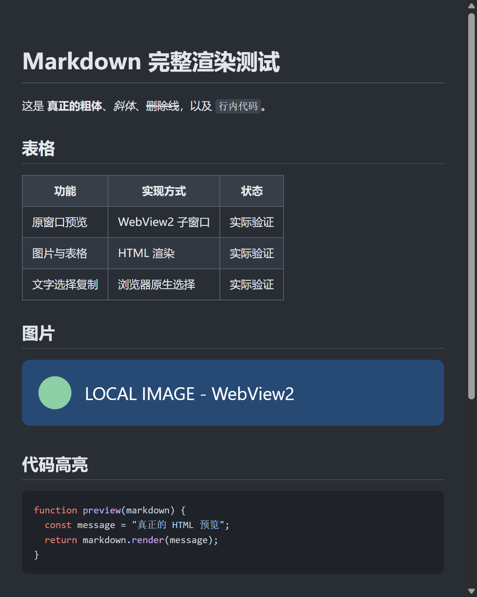

# Sublime Text 富文本 Markdown 预览

[English](README.md) · [MIT 许可证](LICENSE)

在 **Sublime 当前窗口** 中嵌入真正的 WebView2 浏览器，支持 Markdown 实时渲染，以及预览文字选择和复制。

**实验版本，仅支持 Windows x64。** 这是自制插件与原生宿主的组合，不是 Sublime 官方内置浏览器。



## 功能

- 原窗口分栏，保留原文档和未保存的缓冲区。
- 标题、粗体、斜体、表格、图片、代码高亮和任务列表。
- 本地渲染 Mermaid 流程图。
- 预览文字可拖选、Ctrl+C 或右键复制。
- 无需保存即可更新；跟随分栏尺寸，切换标签时自动隐藏。
- 支持未命名文档；关闭预览即退出宿主进程。

## 环境要求

- Windows 10/11 x64、Sublime Text 4 build 4144+。
- Microsoft Edge WebView2 Evergreen Runtime、.NET Framework 4.8。
- 已在 Sublime build 4215、200% DPI 环境实测。其他版本、缩放及多屏环境仍需要验证。

## 安装

从 [Releases](https://github.com/generous-with/sublime-rich-markdown-preview/releases) 下载 Windows 压缩包并解压。关闭已有预览后，在解压目录运行：

```powershell
powershell -NoProfile -ExecutionPolicy Bypass -File tools\install.ps1
```

如果电脑上存在多个 Sublime 数据目录，或使用便携版，请在 **Preferences > Browse Packages** 查看 Packages 路径，并明确指定：

```powershell
powershell -NoProfile -ExecutionPolicy Bypass -File tools\install.ps1 -PackagesPath "X:\YourSublimeData\Packages"
```

安装器会备份旧插件，不修改 User 设置及快捷键。也可手动将解压后的 `RichMarkdownPreview` 文件夹复制到 Packages 目录。

如果安装 0.2.0 后 Alt+M 突然失效，请用安装器升级到 0.2.1 或更新版本。旧版使用了 Package Control 的管理标记文件名，可能被它的孤立插件清理自动删除；新版移除了该标记，不改动 Package Control 设置。手动升级时请完整替换旧插件文件夹，不要仅合并文件。

插件必须以**解压后的文件夹**安装，宿主程序不能直接从 `.sublime-package` 中运行。目前尚未上架 Package Control。发布的宿主 EXE 暂无代码签名，也可以自行从源码编译。

## 使用

打开 Markdown，按 **Alt+M**；也可从命令面板选择 **Rich Markdown: Preview in Current Window**。

默认 Alt+M 仅作用于 Markdown。如果 User 快捷键已占用它，请使用命令面板或自行设置 `rich_markdown_preview` 快捷键。点击预览后键盘由浏览器接收；使用 Sublime 编辑快捷键前，先点回源文档。

关闭预览标签即可退出，也可以执行 **Rich Markdown: Close Preview**。

卸载前关闭预览，然后运行：

```powershell
powershell -NoProfile -ExecutionPolicy Bypass -File tools\uninstall.ps1
```

必要时使用与安装相同的 `-PackagesPath`。卸载保留用户文档与 User 设置。

## 构建和验证

```powershell
python tools\fetch_dependencies.py
powershell -NoProfile -ExecutionPolicy Bypass -File tools\build-host.ps1
python -m unittest discover -s tests -p "test_*.py"
powershell -NoProfile -ExecutionPolicy Bypass -File tools\package.ps1
```

需要 Python 3.8+。依赖下载前已锁定版本，并核对 SHA512/SHA256；源码仓库不包含个人缓存、安装备份、浏览器配置和本机测试日志。发布压缩包包含运行所需文件和第三方许可证。

浏览器测试需运行 `npm install --ignore-scripts`、`npx playwright install chromium` 和 `npm test`。

参见[验证范围](docs/VALIDATION.md)、[架构](docs/ARCHITECTURE.md)和[安全说明](SECURITY.md)。

## 当前限制

- 暂不支持数学公式扩展及相对文件链接跳转。远程图片会发起网络请求。
- 不保证与 Qoder 等其他编辑器的主题、字体或扩展效果逐像素一致。
- Sublime、Windows 或 WebView2 更新后需要复核原生嵌入；插件重载会关闭预览。
- 尚未全面验证读屏、多屏 DPI 切换、输入法及大文档性能。

本项目集成代码采用 MIT，第三方依赖保留各自许可证，详见[第三方声明](THIRD_PARTY_NOTICES.md)。
